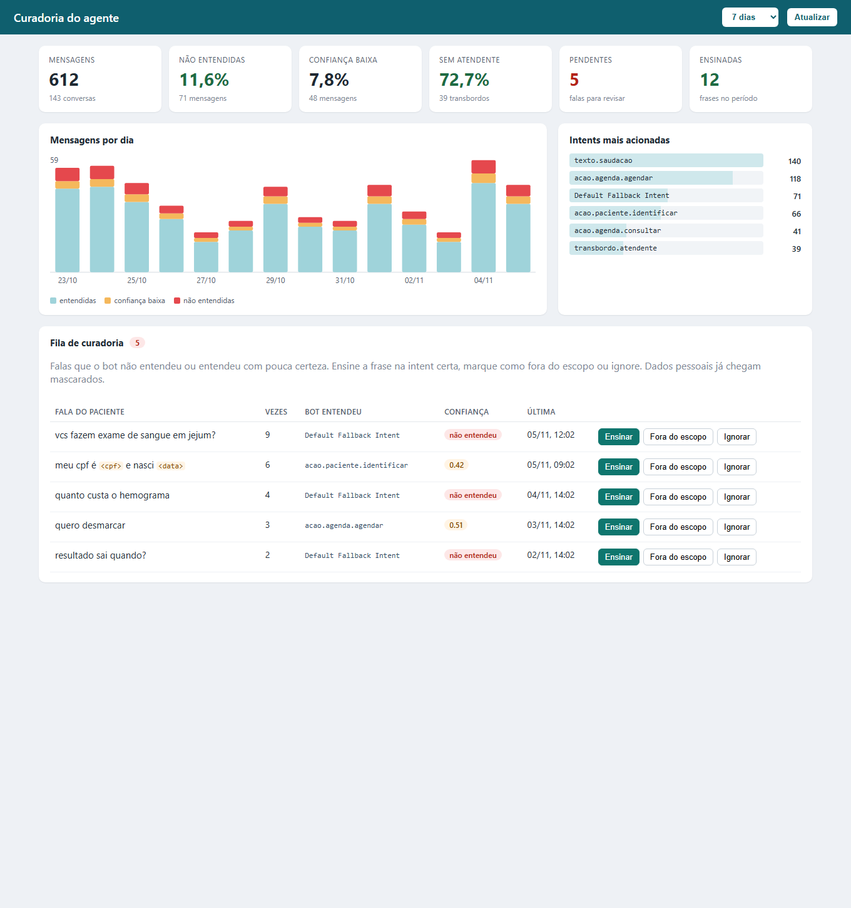

# Curadoria do agente

Cada mensagem enviada ao Dialogflow gera um evento `DIALOGFLOW / detect_intent` em
`observability.flow_event` (requer `OBSERVABILITY_POSTGRES_ENABLED=true`). Em `details`:

| Campo | Conteúdo |
|---|---|
| `texto` | Fala do paciente com `<cpf>`, `<data>`, `<telefone>`, `<email>` e `<numero>` (5+ dígitos) no lugar dos dados |
| `confianca` | `intentDetectionConfidence` do Dialogflow (0 a 1) |
| `fallback` | `true` quando caiu numa intent de fallback |

Nomes próprios não são mascarados: o texto continua sendo dado pessoal de saúde (LGPD).
Restrinja o acesso ao banco e apague o histórico antigo (abaixo). Para não guardar a fala,
use `OBSERVABILITY_CURADORIA_TEXTO=false`.

## Tela de curadoria



Em `/curadoria` (ex.: `https://bs-api.jscinfor.com/curadoria`), com usuário e senha próprios:

- Indicadores do período: mensagens, % não entendidas, % confiança baixa, % sem atendente, pendentes e frases ensinadas.
- Gráfico por dia e intents mais acionadas.
- Fila: falas que caíram no fallback ou ficaram abaixo de `CURADORIA_LIMITE_CONFIANCA`, agrupadas.
  - **Ensinar**: edite a frase (troque `<cpf>`, `<data>` etc. por exemplos fictícios), escolha a intent e
    a frase entra como exemplo de treino no Dialogflow; o agente é retreinado.
  - **Fora do escopo** / **Ignorar**: só registra a decisão.
  - Decidida, a fala sai da fila (`observability.curadoria_decisao`, com quem decidiu).

Configuração no Coolify:

```
CURADORIA_ENABLED=true
```

A tela fica na central de administração (`/admin`), com o login de `ADMIN_USER`/`ADMIN_PASSWORD`. Para quem só
faz curadoria, `CURADORIA_USER`/`CURADORIA_PASSWORD` criam um login que enxerga apenas esta tela.

Requer `OBSERVABILITY_POSTGRES_ENABLED=true` e `OBSERVABILITY_POSTGRES_INITIALIZE_SCHEMA=true`
(cria a tabela de decisões). Para **Ensinar**, a conta de serviço do Dialogflow precisa do papel
**Dialogflow API Admin** no IAM (o **Dialogflow API Client** só conversa). A frase vai para o agente
draft; com `DIALOGFLOW_ENVIRONMENT` definido, publique uma versão nova para valer no ambiente.

O resumo diário destes indicadores chega ao grupo do Telegram pelo OpenClaw: [relatórios pelo OpenClaw](relatorios-openclaw.md).
Os botões **Resumo do dia**, **Conversão do dia** e **Relatório semanal** mostram o texto que o OpenClaw recebe.
Com os relatórios ligados, o card **Conversão** mostra quantas conversas do período terminaram com consulta ou
exame marcado pelo bot ([como ler](relatorios-openclaw.md#como-ler-a-conversão)).

## Rotina semanal

1. Abrir a tela de curadoria e revisar a fila.
2. Para cada frase: ensinar na intent certa, marcar como fora do escopo ou ignorar. Intent nova se cria no console do Dialogflow.
3. Virar as correções em casos de [regressão conversacional](testes-regressao-conversacional.md), rodar e publicar o agente.

## Consultas

As mesmas informações da tela, direto no banco.

Fila de curadoria (últimos 7 dias, frases repetidas agrupadas):

```sql
SELECT lower(details->>'texto') AS texto,
       count(*) AS vezes,
       max(intent) AS intent,
       round(avg((details->>'confianca')::numeric), 2) AS confianca,
       bool_or((details->>'fallback')::boolean) AS fallback,
       max(created_at) AS ultima
FROM observability.flow_event
WHERE component = 'DIALOGFLOW' AND stage = 'detect_intent'
  AND created_at > now() - interval '7 days'
  AND ((details->>'fallback')::boolean OR (details->>'confianca')::numeric < 0.6)
GROUP BY 1
ORDER BY vezes DESC, ultima DESC
LIMIT 100;
```

Indicadores por dia:

```sql
SELECT date_trunc('day', created_at)::date AS dia,
       count(*) AS mensagens,
       round(100.0 * count(*) FILTER (WHERE (details->>'fallback')::boolean) / count(*), 1) AS pct_fallback,
       round(100.0 * count(*) FILTER (WHERE (details->>'confianca')::numeric < 0.6) / count(*), 1) AS pct_baixa_confianca,
       count(DISTINCT conversation_id) AS conversas,
       count(DISTINCT conversation_id) FILTER (WHERE intent LIKE 'transbordo.%') AS transbordos
FROM observability.flow_event
WHERE component = 'DIALOGFLOW' AND stage = 'detect_intent'
  AND created_at > now() - interval '30 days'
GROUP BY 1
ORDER BY 1 DESC;
```

Intents mais acionadas e confiança média:

```sql
SELECT intent, count(*) AS vezes, round(avg((details->>'confianca')::numeric), 2) AS confianca
FROM observability.flow_event
WHERE component = 'DIALOGFLOW' AND stage = 'detect_intent'
  AND created_at > now() - interval '30 days'
GROUP BY intent
ORDER BY vezes DESC;
```

Retenção (ex.: 90 dias):

```sql
DELETE FROM observability.flow_event WHERE created_at < now() - interval '90 days';
```
