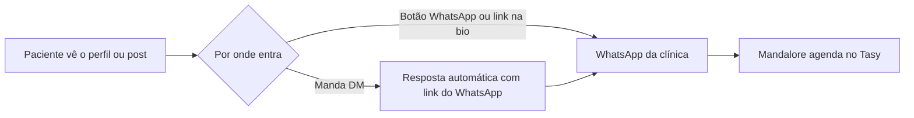

# Instagram levando ao WhatsApp do Mandalore

O paciente começa no Instagram da clínica e termina o agendamento no WhatsApp, onde o Mandalore atende. Não há integração por API: tudo é configuração da própria clínica no Instagram e no Meta Business Suite.

A primeira implantação é numa clínica. Para hospital, o roteiro é o mesmo.

| Item | Situação |
|---|---|
| Custo no Instagram | Nenhum |
| App na Meta | Não precisa |
| Código no Mandalore | Nenhum |
| Quem configura | A clínica, na conta dela |
| Dados sensíveis (CPF, nascimento) | Só no WhatsApp |

Use este modelo enquanto não houver integração direta do Instagram pelo Chatwoot (veja `chatwoot.md`, seção Canais).

## Caminho do paciente



## 1. Conta profissional

O Instagram precisa ser conta profissional do tipo **Empresa**. Sem isso não há resposta automática nem botão de contato.

1. No app do Instagram: Perfil → menu → **Tipo de conta e ferramentas** → **Mudar para conta profissional**.
2. Categoria: "Clínica médica" ou a especialidade da clínica (por exemplo, "Dermatologista", "Dentista", "Centro de diagnóstico").
3. Tipo: **Empresa** (não Criador de conteúdo).
4. No Meta Business Suite, vincule o Instagram à página do Facebook da clínica.

Conta privada vira pública na troca, e as solicitações pendentes de seguidores são aceitas. Referência: [Central de Ajuda do Instagram](https://help.instagram.com/502981923235522).

## 2. Link do WhatsApp

Monte um link `wa.me` com o número do Mandalore (DDI + DDD + número, só dígitos) e uma mensagem pronta:

```text
https://wa.me/5511999999999?text=Ol%C3%A1!%20Vim%20pelo%20Instagram%20e%20quero%20agendar
```

O paciente abre o WhatsApp com "Olá! Vim pelo Instagram e quero agendar" já digitado e só toca em enviar.

Use um texto diferente por origem para medir de onde vêm os agendamentos:

| Origem | Mensagem pronta |
|---|---|
| Instagram | `Olá! Vim pelo Instagram e quero agendar` |
| Site | `Olá! Vim pelo site e quero agendar` |
| Facebook | `Olá! Vim pelo Facebook e quero agendar` |

Acentos e espaços precisam estar codificados na URL (`á` = `%C3%A1`, espaço = `%20`). Teste o link no celular antes de publicar.

## 3. Perfil

| Onde | Como | Observação |
|---|---|---|
| Botão WhatsApp | Editar perfil → Opções de contato (ou Botões de ação) → WhatsApp | O número do Mandalore está na API (Twilio), não no app WhatsApp Business. O Instagram pode não conseguir confirmar por código. Se a conta do WhatsApp estiver no mesmo portfólio comercial, vincule pelo Meta Business Suite. Se não der, use os links abaixo |
| Links da bio | Editar perfil → Links → link `wa.me`, título "Agendar consulta ou exame" | Funciona com qualquer número |
| Destaque fixo | Story com figurinha de link para o `wa.me`, salvo no destaque "Agendar" | Fica sempre visível no perfil |

## 4. Respostas automáticas na DM

Meta Business Suite → **Caixa de entrada** → **Automações**. Os nomes podem variar conforme a versão.

### Resposta instantânea

Vai na primeira mensagem de cada pessoa.

```text
Olá! Para agendar consultas e exames, fale com nosso assistente no WhatsApp, que atende 24 horas: wa.me/5511999999999

Se preferir, deixe sua dúvida aqui que nossa recepção responde no horário de atendimento.
```

### Perguntas frequentes

Botões que aparecem quando o paciente abre a conversa.

| Pergunta | Resposta |
|---|---|
| Quero agendar | `Agende pelo nosso assistente no WhatsApp, a qualquer hora: wa.me/5511999999999` |
| Convênios aceitos | `Atendemos [lista de convênios]. Para confirmar seu plano e agendar: wa.me/5511999999999` |
| Endereço e horários | `[Endereço]. Atendimento de [dias] das [hora] às [hora].` |
| Preparo de exames | `O preparo depende do exame. Nosso assistente no WhatsApp envia as orientações ao agendar: wa.me/5511999999999` |

### Respostas por palavra-chave

| Palavras | Resposta |
|---|---|
| `agendar`, `agenda`, `marcar`, `consulta`, `exame`, `horário`, `remarcar`, `cancelar` | `Você pode agendar, remarcar ou cancelar pelo nosso assistente no WhatsApp: wa.me/5511999999999` |

### Mensagem de ausência

Fora do horário da recepção.

```text
Nossa recepção volta [dia] às [hora]. Para agendar agora, use nosso assistente no WhatsApp: wa.me/5511999999999
```

Não peça CPF, data de nascimento ou dados de saúde pela DM. Esses dados ficam no WhatsApp, com o Mandalore.

## 5. Divulgação

- Legendas: "Agende pelo link da bio".
- Stories de campanha com figurinha de link para o `wa.me`.
- Respostas a comentários com dúvida de agendamento: "Enviamos o link na DM" ou "Agende pelo link da bio".

## No Mandalore

| Verificação | Como |
|---|---|
| A mensagem pronta inicia o agendamento | Envie `Olá! Vim pelo Instagram e quero agendar` para o número. Se cair na saudação genérica, inclua a frase como exemplo de treino na intent de agendamento do Dialogflow |
| Origem aparece na trilha | O texto da primeira mensagem identifica a origem nos logs e na trilha de observabilidade |
| Atendente humano | Quem pedir atendente no WhatsApp segue o transbordo normal para a recepção |

## Prova

1. Abra o perfil do Instagram em outro celular, sem ser administrador.
2. Toque no link da bio. O WhatsApp abre com a mensagem pronta.
3. Envie. O Mandalore responde com o início do agendamento.
4. Volte ao Instagram e mande "quero agendar" na DM. A resposta automática chega com o link.
5. Mande uma mensagem fora do horário da recepção. Chega a mensagem de ausência.

## Limites

| Limite | Efeito |
|---|---|
| Troca de aplicativo | Parte dos pacientes desiste entre o Instagram e o WhatsApp |
| Sem conversa livre na DM | O Instagram só envia as respostas fixas; o bot não responde dúvidas abertas ali |
| Custo do WhatsApp | A conversa no WhatsApp segue a tarifa da Meta e da Twilio. Conversa iniciada pelo paciente costuma ser a mais barata |

Para atender dentro do próprio Instagram, o caminho é a caixa de Instagram no Chatwoot. No Chatwoot instalado no servidor, ela exige um app próprio aprovado na Meta. No Chatwoot Cloud, usa o app da Chatwoot.
